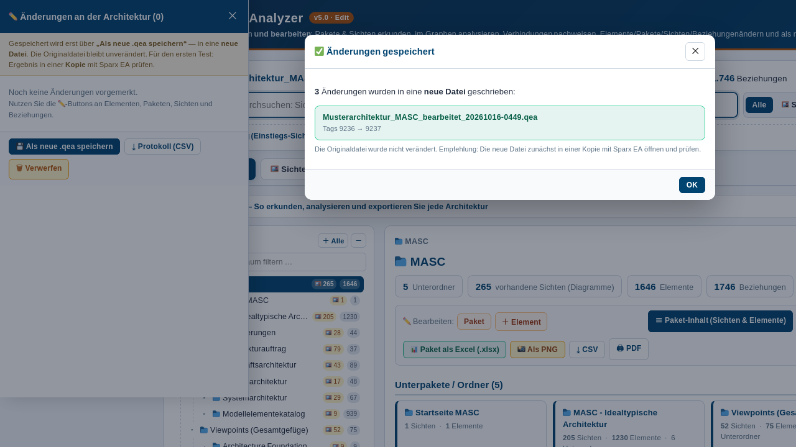

# Architektur Mate

**Sparx-EA-Architekturen im Browser bearbeiten — 100 % lokal, ohne KI, ohne Installation, ohne Server.**

Einzeldatei-Tool (HTML & ASPX) für Architekturmodelle im SQLite-Format (`.qea` / `.eapx` / `.qeax`):
Elemente, Pakete, Sichten, Beziehungen und Tagged Values **ändern**, Elemente & Beziehungen **anlegen** und **entfernen** — geschrieben wird in eine **neue `.qea`-Datei**, das Original bleibt unangetastet.

Ab **v6.0** zusätzlich: **mehrere Architekturen gleichzeitig laden** und zu einer Landkarte verschmelzen — mit frei wählbaren Kriterien (**GUID**, **Name**, **Alias**), wie Elemente erkannt und zusammengelegt werden. Dadurch werden **modellübergreifende Zusammenhänge sichtbar**.

> **Testphase — Feedback willkommen.** Dies ist eine **Edit-Edition zum Mit-Testen**. Bitte mit einer **Kopie** des Modells arbeiten und die erzeugte Datei vor der Weiterverwendung einmal in Sparx EA öffnen und prüfen. Rückmeldungen (auch Fehlerfälle) sind ausdrücklich erwünscht.


---

## Einfache Anleitung

### 1 · Öffnen
Lade `dist/Architektur_Mate.html` herunter (Button *Raw* → *Datei speichern*) und öffne sie per **Doppelklick** im Browser (aktueller Edge, Chrome oder Firefox). Keine Installation, kein Server, kein Netz nötig.

### 2 · Laden
Im Startbereich zwei Möglichkeiten:

| Button | Wann |
|---|---|
| **📄 Eine Architektur laden** | eine einzelne `.qea`-Datei |
| **🗂️ Mehrere Architekturen verschmelzen** | zwei oder mehr Dateien zu **einer** Landkarte |

Einfach die Datei(en) auf die Fläche ziehen oder anklicken. Werden im Auswahldialog **mehrere Dateien** gewählt, wirkt das automatisch wie „Verschmelzen".

### 3 · (Nur bei mehreren Architekturen) Kriterien wählen
Vor dem Laden stellst du ein, **wie** Elemente aus den verschiedenen Architekturen als gleich erkannt werden:

| Kontrollkästchen | Wirkung |
|---|---|
| ☑ **Semantik einbeziehen** | Gesamt-Schalter: zusammenführen ja/nein |
| ☑ **Über GUID** | gleiche Kennung (URI / UUID aus dem Referenzstandard) |
| ☑ **Über den Namen** | gleiche Bezeichnung |
| ☐ **Über den Alias** | gleicher Alternativname |

Jedes Kriterium ist **einzeln an- und abwählbar** — allein oder kombiniert. Ein Element wird zusammengelegt, sobald es in einem der aktivierten Merkmale übereinstimmt. Standardmäßig ist nur **GUID** aktiv, weil es die **stabilste** Erkennung ist.

> ⚠️ **Achtung:** Je mehr Kriterien Sie zusätzlich ankreuzen, desto **instabiler** wird die Anwendung und desto höher ist die Wahrscheinlichkeit, dass sie **abstürzt**. „Über den Namen" und „Über den Alias" gelten als **experimentell**.

Nach dem Laden findest du dieselben Kontrollkästchen **in der Leiste unter dem Startbereich** — dort kannst du sie jederzeit umschalten, ohne neu zu laden.

### 4 · Vorschau prüfen und bestätigen
Beim Laden zeigt ein **Prüf-Dialog** jede erkannte Übereinstimmung einzeln an, nach dem Kriterium gruppiert:

* Erkannt über die **GUID** …
* Erkannt über den **Namen** …
* Erkannt über den **Alias** …

Du kannst **einzeln Häkchen entfernen**, wenn ein Element bewusst eigenständig bleiben soll, und dann bestätigen:

* **✔ Ausgewählte zusammenlegen**
* **Ohne Zusammenführung fortfahren** (die Architekturen bleiben dann nebeneinander, ohne Verknüpfung)

### 5 · Erkunden
* **Pakete & Sichten** links im Baum, dazu alle Ansichten aus dem Analyse-Bereich
* **Sofort-Suche** über alle Elemente
* **Steckbrief** zeigt bei verschmolzenen Elementen, in **welchen Architekturen** sie vorkommen — mit **Sprung-Button** zum Vorkommen in der jeweils anderen Datei
* **Beziehungen** sind mit der Spalte *Architektur* versehen; Verbindungen über die Dateigrenze tragen den Marker **„Modellgrenze"** und werden hervorgehoben

### 6 · Ändern und Speichern
* ✏️-Buttons im Steckbrief, in Tabellen und an Paketen/Sichten öffnen die Bearbeitung
* Alle Änderungen landen in einer **Änderungsliste** (Alt → Neu, einzeln entfernbar)
* **„💾 Als neue .qea speichern"** schreibt in eine **neue Datei** (z. B. `…_bearbeitet_20261016-1620.qea`) — im Mehrdatei-Modus bekommt **jede Quelldatei** ihre eigene, veränderte Datei zurück
* Das **Original wird nie überschrieben**

### 7 · Prüfen
Ergebnis vor der Weiterverwendung einmal in **Sparx EA** öffnen. Am besten immer mit einer **Kopie** arbeiten.

---

## Was das Tool kann

### Bearbeiten

| Objekt | Änderbar |
|---|---|
| **Element** | Name, Stereotype, Alias, Status, Beschreibung/Notiz |
| **Paket** | Name, Beschreibung (wird in `t_package` **und** der gespiegelten `t_object`-Zeile gepflegt) |
| **Sicht / Diagramm** | Name, Beschreibung |
| **Beziehung** | Name, Stereotype (inkl. `t_xref`-Eintrag und «…»-Label), Richtung, Beschreibung |
| **Tagged Values** | ändern, ergänzen, entfernen |

### Anlegen & Entfernen
* **Neu:** Elemente in einem Paket (beliebiger Objekttyp), Beziehungen zwischen zwei Elementen (mit Zielsuche über Name/Alias/Stereotype).
* **Löschen:** einzelne Elemente mit vollständiger **Kaskade** (Beziehungen, Sicht-Platzierungen, Tags, Diagramm-Links, Attribut-/xref-Einträge) und einzelne Beziehungen.

### Prinzip: Vormerken statt Sofort-Schreiben
Alle Änderungen landen in einer **Änderungsliste** (mit Alt→Neu-Gegenüberstellung, einzeln entfernbar) und werden erst über **„💾 Als neue .qea speichern"** geschrieben — in eine **neue Datei**. Änderungsprotokoll als CSV exportierbar.

### Mehrere Architekturen (Multi-Modus)
* Beliebig viele `.qea`-Dateien zu einer **Landkarte** verschmelzen
* **Kennungen bleiben klar:** Modell 1 behält die Original-IDs, ab Modell 2 kommen Präfixe wie `m2_o145` (Element), `m2_p12` (Paket) hinzu
* **Fusion** über frei wählbare Kriterien (GUID / Name / Alias) mit Vorschau und Einzelabwahl
* **Modellübergreifender Fokus:** Der Steckbrief zeigt alle Vorkommen, mit Sprung zum Vorkommen in der jeweils anderen Architektur; die Beziehungstabelle markiert Verbindungen über die Modellgrenze
* **Getrenntes Speichern:** jede Quelldatei wird separat zurückgeschrieben
* **„✕ Auflösen"** nimmt die Verschmelzung zurück, es bleibt die erste Architektur

### Analyse inklusive
Die vollständige Analyse-Funktionalität des [ADMBw QEA Analyzers](https://github.com/Mitchel85/admbw-qea-analyzer) ist enthalten: Paket- & Sichten-Explorer, globale Sofort-Suche, interaktiver Graph (ADMBw/NAFv4-Farben), Verbindungs-/Pfadanalyse mit Architektur-Diagnose sowie 1-Klick-Export jeder Sicht als **PNG** oder **Excel (.xlsx)**.




---

## Deployment (SharePoint / Bw-Netz)

| Datei | Verwendung |
|---|---|
| `dist/Architektur_Mate.html` | Lokale Nutzung (Doppelklick) oder SharePoint-Dokumentbibliothek |
| `dist/Architektur_Mate.aspx` | SharePoint-/IIS-Bibliothek (beginnt direkt mit `<!DOCTYPE html>`) |

**Wichtig:** Die ASPX-Datei beginnt **direkt mit `<!DOCTYPE html>`** — es wird **keine** `<%@ Page … %>`-Direktive vorangestellt. Beide Dateien sind **UTF-8 mit BOM** und enthalten keine `<%`-Sequenzen. Details: [docs/SharePoint-Deployment.md](docs/SharePoint-Deployment.md)

## Technischer Aufbau

Eine einzige HTML-Datei (~1,32 MB), modular aus Bausteinen gebaut:

```
src/part1_head_body.html   Struktur & Design (CSS, Reiter, Ansichten, Edit-UI, Multi-Bedienung)
src/part2_app_core.js      Modell-Aufbau, Suche, Exporte, Multi-Modus, Kriterien (GUID/Name/Alias)
src/part3_app_graph.js     Diagramme, Steckbriefe, interaktiver Graph, Modellband/Fokus
src/part4_path.js          Verbindungs-/Pfadanalyse (BFS, Alternativpfade, Diagnose)
src/part5_edit.js          Edit-Modus: Änderungsliste, Editoren, SQLite-Schreibpfad
vendor/sql-wasm.js/.wasm   sql.js (MIT) — eingebettete SQLite-Engine für den Schreibpfad
src/build_release.py       Assembler: baut HTML + ASPX, bettet WASM ein (node --check)
```

```bash
python3 src/build_release.py   # Pfade im Skript ggf. anpassen
```

### Wie das Schreiben funktioniert
Die `.qea`-Datei ist eine SQLite-Datenbank. Zum Schreiben wird eine **echte SQLite-Engine** (sql.js, als WebAssembly eingebettet) im Browser gestartet — die Datei bleibt damit strukturell eine valide EA-Datenbank. Vor jedem Export laufen `PRAGMA integrity_check` und ein Selbsttest mit dem eingebauten Reader.

Dabei werden die EA-Konventionen berücksichtigt: getrennte AUTOINCREMENT-Sequenzen je Tabelle, Paket-Spiegelung über `ea_guid`, entity-kodierte Notizen (`&#252;`, CRLF), `t_xref`-Stereotype-Einträge (inkl. `FQName`), «…»-Labels auf Diagrammen sowie die vollständigen Lösch-Kaskaden.

### Wie das Verschmelzen funktioniert (Multi-Modus)
Beim Laden wird jedes Element über die gewählten Kriterien mit vorhandenen Elementen verglichen:

* **GUID**: Tags mit Muster `*uri*`, `*uuid*`, `*guid*`, `*identifier*` (Referenzstandard-Stempel wie `NAFv4-FQName`)
* **Name**: normalisierte Bezeichnung (Groß-/Kleinschreibung und Akzente werden egalisiert)
* **Alias**: normalisierter Alternativname

Ein **leerer Wert zählt nie als Treffer** — sonst würden alle namenlosen Elemente auf einen einzigen Knoten abgebildet. Beim Kriterium „Name" wird bewusst **kein** Stereotyp erzwungen: gleichnamige Elemente finden sich auch dann zusammen, wenn der Stereotyp unterschiedlich geschrieben ist. Wer zusätzlich den Stereotyp abgleichen will, prüft die Treffer im Vorschau-Dialog und wählt einzelne Positionen ab.

### Sicherheit
* Das Modell verlässt den Rechner **nicht** — keine Netzverbindung, kein CDN, keine Telemetrie.
* Die geöffnete Originaldatei wird **nie** überschrieben.
* Es wird ausschließlich die vom Nutzer geladene Datei gelesen und eine neue Datei erzeugt.

---

## Getestet mit

Musterarchitektur **MASC** (12,4 MB; 225 Pakete, 265 Sichten, 1.652 Elemente, 1.746 Beziehungen) und **Testarchitektur** (149 Pakete, 77 Sichten, 567 Elemente, 421 Beziehungen):

* **Multi-Modus:** 2 Dateien verschmolzen → 374 Pakete, 342 Sichten, 1.931 Elemente, 2.167 Beziehungen, **56 Beziehungen über die Modellgrenze**
* **Kriterien** (MASC + Testarchitektur): Nur GUID = **206** Treffer · Nur Name = **293** · Beide zusammen = **293** · Nichts aktiv = **0**
* **Verbindungsanalyse** (Einzel & Cross-Model): Pfade in beiden Modi gefunden — auch über die Modellgrenze (19/19 grün)
* **Vorauswahl:** nur „Über GUID" aktiv; „Über den Namen" und „Über den Alias" sind als **experimentell** markiert, mit Warnhinweis zur Absturzgefahr
* **Edit & Speichern** je Quelldatei getrennt — alle Struktur- und Integritätsprüfungen grün
* **10 Änderungsarten** (Umbenennen, Stereotype, Notizen, Tags, Anlegen, Löschen inkl. Kaskaden) — alle Prüfungen grün
* Speichern inkl. Integritätsprüfung: **~3 Sekunden**
* Automatisierte End-zu-Ende-Tests (Bedienung, Fusion, Kriterien, Pfade, Speichern): **19/19 grün**

Testmodell: `https://github.com/Mitchel85/eam-qea-tool` → `Demo-Output/Musterarchitektur_MASC.qea`

## Mitmachen / Feedback

Dieses Repository ist **bewusst als Testversion** veröffentlicht. Interessant sind besonders:
* Modelle, bei denen etwas **nicht** wie erwartet funktioniert (Lösch-Kaskaden, Sonder-Stereotype, große Dateien, verschmelzende Modelle)
* Rückmeldungen aus der **Praxis mit Sparx EA** (öffnet EA die erzeugte Datei sauber?)
* Hinweise zu EA-Konventionen, die noch nicht berücksichtigt sind
* Wünsche zu weiteren Kriterien für das Verschmelzen (z. B. Stereotyp mit abgleichen)

Am einfachsten per **Issue** hier im Repository — gerne mit kurzer Beschreibung, EA-Version und ggf. anonymisiertem Beispielfall.

## Verwandte Projekte

| Repository | Zweck |
|---|---|
| [admbw-qea-analyzer](https://github.com/Mitchel85/admbw-qea-analyzer) | Analyse-Version (nur lesen, kein Bearbeiten, kein Verschmelzen) |
| [eam-qea-tool](https://github.com/Mitchel85/eam-qea-tool) | Natürlichsprachliche Abfragen an QEA-Modelle |
| [admbw-extractor](https://github.com/Mitchel85/admbw-extractor) | ADMBw-Viewpoints aus Prosa ableiten |
| [sparx-ea-scripts](https://github.com/Mitchel85/sparx-ea-scripts) | JavaScript-Automatisierung in Sparx EA |

---

*Autor: Michael Estel*
*Enthält [sql.js](https://github.com/sql-js/sql.js) (MIT-Lizenz) — siehe `vendor/LICENSE-sql.js`.*

## Rechtliches

* **Keine Verbindung zu Sparx Systems.** Dieses Werkzeug ist ein unabhängiges, privat erstelltes Projekt. Es steht in keiner Verbindung zu Sparx Systems Pty Ltd., ist von dort **nicht** freigegeben oder zertifiziert und verwendet keine Logos oder Marken von Sparx Systems. Die Bezeichnungen „Sparx Systems", „Enterprise Architect" und „EA" werden ausschließlich **beschreibend** verwendet, um den Dateityp zu benennen, den dieses Werkzeug öffnet.
* **Direkter Datenbankzugriff:** Das Werkzeug liest und schreibt `.qea`-Dateien direkt als SQLite-Datenbank. Die Original-Datei wird **nie** überschrieben — beim Speichern entsteht stets eine neue Datei (`*_bearbeitet_JJJJMMTT-HHMM.qea`).
* **Hinweis zum Support:** Ein direkter Schreibzugriff auf die Datenbank ist von Sparx Systems nicht freigegeben. Ein beschädigtes Modell kann Auswirkungen auf einen bestehenden Wartungs- bzw. Supportvertrag haben. Bitte stets mit einer **Arbeitskopie** arbeiten und das Ergebnis in Enterprise Architect prüfen.
* **Kein EA-Bestandteil:** Es werden keine Dateien, Bibliotheken, Lizenzschlüssel oder Programmbestandteile von Sparx Systems mitgeliefert oder umgangen.
