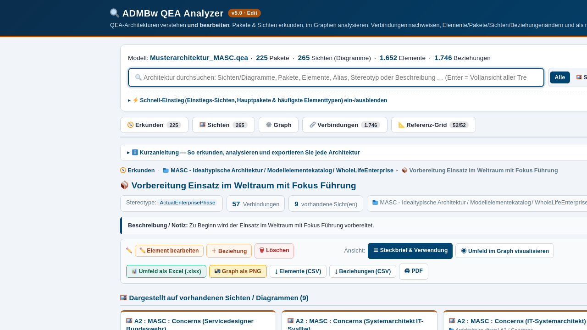
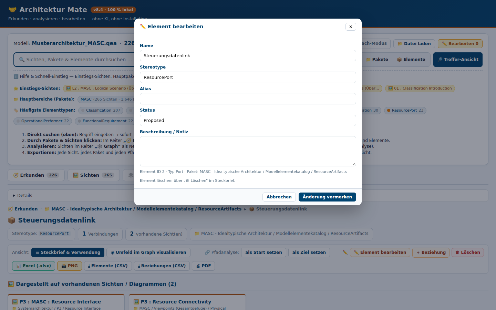
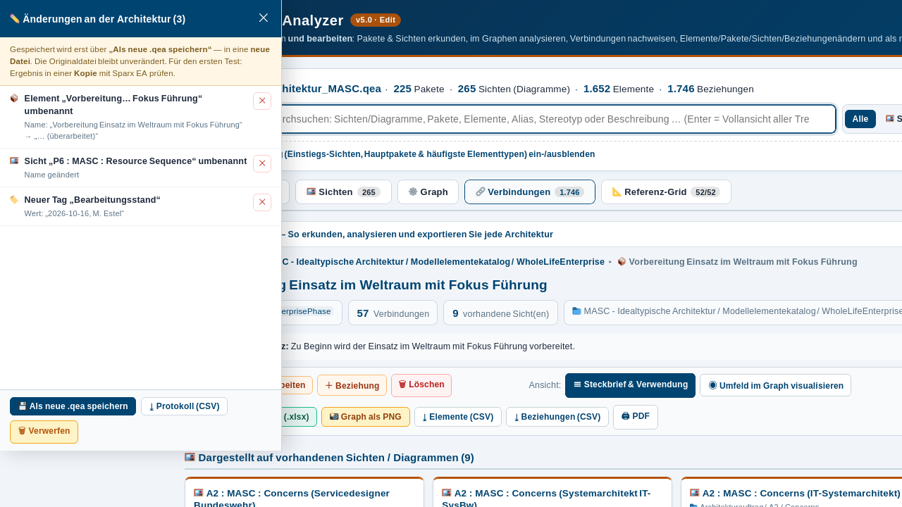

# Architektur Mate

[](https://github.com/Mitchel85/Architektur-Mate/actions/workflows/ci.yml)

**Sparx-EA-Architekturen im Browser bearbeiten — 100 % lokal, ohne KI, ohne Installation, ohne Server.**

Einzeldatei-Tool (HTML & ASPX) für Architekturmodelle im SQLite-Format (`.qea` / `.eapx` / `.qeax`): Elemente, Pakete, Sichten, Beziehungen und Tagged Values **ändern**, **anlegen** und **entfernen**. Geschrieben wird stets in eine **neue `.qea`-Datei** — das Original bleibt unangetastet.

Ab **v6.0**: **mehrere Architekturen gleichzeitig laden** und zu einer Landkarte verschmelzen (Kriterien: **GUID** / **Name** / **Alias**). Dadurch werden modellübergreifende Zusammenhänge sichtbar.

> **Testphase — Feedback willkommen.** Bitte mit einer **Kopie** des Modells arbeiten und die erzeugte Datei vor der Weiterverwendung einmal in Sparx EA öffnen.



---

## Schnellstart

1. **Öffnen** — `dist/Architektur_Mate.html` herunterladen (Button *Raw* → *Datei speichern*) und per **Doppelklick** im Browser öffnen (Edge / Chrome / Firefox).
2. **Laden** — **„📄 Eine Architektur laden"** (eine Datei) oder **„🗂️ Mehrere verschmelzen"** (zwei oder mehr zu einer Landkarte). Datei(en) aufziehen oder anklicken.
3. **(Nur mehrere) Kriterien wählen** — unter **„⚙️ Erweitert"**: Standard ist nur **„Über GUID"** (stabilste Erkennung). „Über den Namen" / „Über den Alias" sind experimentell. Danach erscheint ein **Prüf-Dialog** zum Einzelabwählen, dann **„✔ Ausgewählte zusammenlegen"**.
4. **Erkunden** — links der Paket-/Sichten-Baum, oben die **Sofort-Suche**. Steckbrief zeigt bei verschmolzenen Elementen alle Vorkommen (mit Sprung-Button); Verbindungen über die Dateigrenze sind mit **„Modellgrenze"** markiert.
5. **Ändern & Speichern** — ✏️ klicken → Feld ändern (wird **vorgemerkt**). **„💾 Als neue .qea speichern"** schreibt in eine **neue Datei**; im Mehrdatei-Modus bekommt jede Quelldatei ihre eigene.

**Wichtig:** Das Original wird nie überschrieben. Ergebnis einmal in Sparx EA prüfen. Am besten mit einer Kopie arbeiten.

---

## Was das Tool kann

| Bereich | Umfang |
|---|---|
| **Bearbeiten** | Element, Paket, Sicht, Beziehung, Tagged Values — jeweils Name, Stereotype, Alias, Status, Beschreibung |
| **Anlegen** | Neue Elemente in einem Paket, neue Beziehungen (mit Zielsuche) |
| **Löschen** | Elemente (mit vollständiger Kaskade) und Beziehungen |
| **Prinzip** | Alle Änderungen landen in einer **Änderungsliste** (Alt→Neu, einzeln entfernbar), geschrieben wird erst beim Speichern |
| **Multi-Modus** | Beliebig viele `.qea`-Dateien zu einer Landkarte; Kennungen bleiben klar (`m2_o145` ab Modell 2); „✕ Auflösen" nimmt die Fusion zurück |
| **Analyse** | Vollständiger [ADMBw QEA Analyzer](https://github.com/Mitchel85/admbw-qea-analyzer) enthalten: Explorer, Sofort-Suche, interaktiver Graph (ADMBw/NAFv4-Farben), Pfadanalyse, 1-Klick-Export je Sicht als PNG oder Excel |
| **Komfort** | Dunkelmodus (automatisch nach Systemeinstellung), Sofort-Suche, Tausender-Formatierung, kurze Export-Schaltflächen mit Tooltips |




---

## Deployment (SharePoint / Bw-Netz)

| Datei | Verwendung |
|---|---|
| `dist/Architektur_Mate.html` | Lokale Nutzung (Doppelklick) oder SharePoint-Dokumentbibliothek |
| `dist/Architektur_Mate.aspx` | SharePoint-/IIS-Bibliothek (beginnt direkt mit `<!DOCTYPE html>`, UTF-8 mit BOM) |

---

## Technischer Aufbau

Eine einzige HTML-Datei (~1,32 MB), modular gebaut:

```
src/part1_head_body.html   Struktur & Design (CSS, Reiter, Ansichten, Edit-UI, Multi-Bedienung)
src/part2_app_core.js      Modell-Aufbau, Suche, Exporte, Multi-Modus, Kriterien
src/part3_app_graph.js     Diagramme, Steckbriefe, interaktiver Graph, Fokus
src/part4_path.js          Verbindungs-/Pfadanalyse (BFS, Alternativpfade, Diagnose)
src/part5_edit.js          Edit-Modus: Änderungsliste, Editoren, SQLite-Schreibpfad
vendor/sql-wasm.js/.wasm   sql.js (MIT) — eingebettete SQLite-Engine für den Schreibpfad
src/build_release.py       Assembler: baut HTML + ASPX, bettet WASM ein
```

```bash
python3 src/build_release.py
```

Die `.qea`-Datei ist eine SQLite-Datenbank. Zum Schreiben startet eine **echte SQLite-Engine** (sql.js/WebAssembly) im Browser; vor jedem Export laufen `PRAGMA integrity_check` und ein Selbsttest. Berücksichtigt werden die EA-Konventionen (getrennte AUTOINCREMENT-Sequenzen, Paket-Spiegelung über `ea_guid`, entity-kodierte Notizen, `t_xref`-Stereotype-Einträge, Lösch-Kaskaden).

### Sicherheit
- Das Modell verlässt den Rechner **nicht** — keine Netzverbindung, kein CDN, keine Telemetrie.
- Die Originaldatei wird **nie** überschrieben; gelesen wird nur die vom Nutzer geladene Datei.

---

## Getestet mit

Musterarchitektur **MASC** (12,4 MB) und **Zweitarchitektur** — u. a. Multi-Modus (2 Dateien), Kriterien (GUID 206 · Name 293 Treffer), Pfadanalyse (Einzel + Cross-Model, 19/19 grün), Edit & Speichern je Quelldatei.

**Automatisierte End-to-End-Tests:** Bei jedem Push läuft eine Playwright-Suite (echter Chromium, headless) in [GitHub Actions](https://github.com/Mitchel85/Architektur-Mate/actions) — Startbereich, Laden, Suche, Paket-Ansicht, Edit-Änderungsliste, Mehrfach-Modus (Regressionsschutz gegen doppelte Baum-Roots) und Dunkelmodus. Lokal: `pytest tests/test_app.py` (siehe `requirements-dev.txt`).

Testmodell: [eam-qea-tool](https://github.com/Mitchel85/eam-qea-tool) → `Demo-Output/Musterarchitektur_MASC.qea`

---

## Mitmachen

Als **Testversion** veröffentlicht. Interessant sind besonders Modelle mit Fehlverhalten, Rückmeldungen aus der Praxis mit Sparx EA und Hinweise zu noch nicht berücksichtigten EA-Konventionen — am einfachsten per **Issue**.

## Verwandte Projekte

| Repository | Zweck |
|---|---|
| [admbw-qea-analyzer](https://github.com/Mitchel85/admbw-qea-analyzer) | Analyse-Version (nur lesen) |
| [eam-qea-tool](https://github.com/Mitchel85/eam-qea-tool) | Natürlichsprachliche Abfragen |
| [admbw-extractor](https://github.com/Mitchel85/admbw-extractor) | ADMBw-Viewpoints aus Prosa |
| [sparx-ea-scripts](https://github.com/Mitchel85/sparx-ea-scripts) | JS-Automatisierung in Sparx EA |

---

*Autor: Michael Estel · Enthält [sql.js](https://github.com/sql-js/sql.js) (MIT) — siehe `vendor/LICENSE-sql.js`.*

## Rechtliches

* **Keine Verbindung zu Sparx Systems.** Unabhängiges, privat erstelltes Projekt — nicht freigegeben oder zertifiziert. Die Bezeichnungen „Sparx Systems", „Enterprise Architect" und „EA" werden ausschließlich **beschreibend** verwendet.
* **Direkter Datenbankzugriff:** liest und schreibt `.qea`-Dateien direkt als SQLite; Original wird **nie** überschrieben (neue Datei `*_bearbeitet_JJJJMMTT-HHMM.qea`).
* **Support-Hinweis:** Direkter Schreibzugriff ist von Sparx Systems nicht freigegeben; Auswirkungen auf Wartungs-/Supportverträge möglich. Stets mit Arbeitskopie arbeiten und das Ergebnis in Enterprise Architect prüfen.
* **Kein EA-Bestandteil:** Es werden keine Dateien, Bibliotheken, Lizenzschlüssel oder Programmbestandteile von Sparx Systems mitgeliefert oder umgangen.
